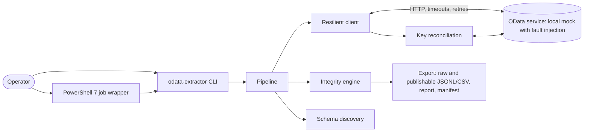
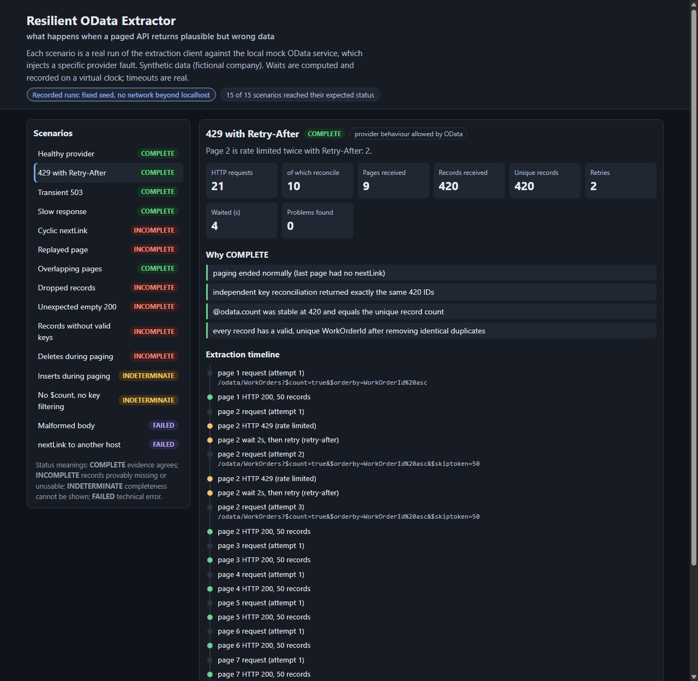
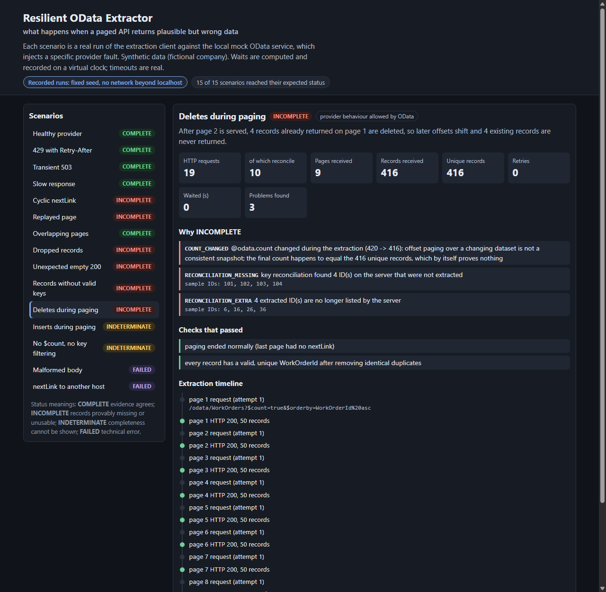

# resilient-odata-extractor

A resilient client for extracting data from OData APIs, with an integrity engine that refuses to call an extraction
complete when the evidence does not support it. It comes with a local mock OData service that injects deterministic
provider faults, schema discovery and privacy-aware JSONL/CSV export. Python standard library at runtime; synthetic
data only.

## 1. Project Overview

Paged APIs fail in two ways. The loud way is a 429, a 503 or a timeout. The quiet way is a 200 that looks fine:
a replayed page, a nextLink that loops, a page with three records missing, a dataset that changes while you page
through it. This project handles the loud failures with bounded, polite retries, and detects the quiet ones. Every
run ends in one of four statuses:

- **COMPLETE**: the evidence agrees;
- **INCOMPLETE**: records are provably missing or unusable;
- **INDETERMINATE**: completeness cannot be shown;
- **FAILED**: a technical error.

Each status comes with its reasons.

## 2. Problem Statement

Typical extraction scripts follow `@odata.nextLink` until it disappears, then report success. That treats "paging
stopped" as "I have everything". A provider can stop early, skip records, repeat pages or change underneath the
client while every response is a valid 200. The goal here is an extractor that:

- retries only what is worth retrying, within limits, and honours `Retry-After`;
- never follows paging links to places it was not pointed at;
- separates technical failure from data-integrity doubt;
- says INDETERMINATE when it cannot know, instead of guessing.

## 3. Features

- Explicit timeouts, retries on 429/502/503/504, timeouts, connection errors and malformed bodies, `Retry-After`
  (seconds or HTTP-date) with a ceiling, and exponential backoff with full jitter.
- Request, page and attempt budgets; nextLink cycle detection; replayed-page detection.
- nextLink allow-list: same scheme, host, port and path as the service root (plus explicit `--allow-host`), no
  credentials in URLs, no redirects followed.
- Integrity engine: key validation against the declared type, deduplication with conflict detection, stable `$count`
  comparison, premature-end detection, order checks, and an **independent keyset reconciliation** of the key.
- Schema discovery from CSDL `$metadata`, or inference from samples with explicit limits.
- Privacy rules for publishable output (drop, mask, keyed pseudonyms, redaction, free-text scrubbing plus a safety
  net); raw and publishable folders kept apart; manifest and `validate` command; CSV formula neutralisation.
- Local mock OData service with 15 deterministic failure scenarios.
- CLI with meaningful exit codes, a PowerShell 7 job wrapper, and a static visual demo built from real runs.

## 4. Architecture



Module map and design decisions: [docs/architecture.md](docs/architecture.md).

## 5. Supported OData Features

The mock implements a **documented subset of OData v4**, not a complete or certified implementation:

- a service document and CSDL `$metadata`;
- collections with server-driven paging and `@odata.nextLink`;
- `Prefer: odata.maxpagesize`;
- `$count`, `$filter` (comparisons joined by `and`), `$orderby`, `$select`, `$top` and `$skip`.

Unsupported options such as `$expand` or `$search` are rejected with an error, never silently ignored.

The mock **deliberately introduces non-conformant behaviour** to test the client's robustness: replayed pages,
cyclic or foreign nextLinks, dropped records, malformed bodies. It also simulates conformant but awkward behaviour:
rate limits, transient errors, data that changes mid-run, missing optional features. Each scenario is labelled in
[docs/odata-subset.md](docs/odata-subset.md).

## 6. Resilience Strategy

| Condition | Response |
| --- | --- |
| 429 / 503 with `Retry-After` | Wait exactly that long (up to 120 s), then retry |
| 429 / 502 / 503 / 504, timeout, connection error, malformed 200 | Backoff `uniform(0, min(cap, base * 2^n))`, retry up to `--max-attempts` |
| Other 4xx/5xx, any redirect | Fail immediately (`HTTP_ERROR`) |
| nextLink to another host, scheme, path or with credentials | Fail before requesting it (`UNSAFE_NEXTLINK`) |
| nextLink already visited | Stop paging, assess what arrived (`NEXTLINK_CYCLE`) |
| Page or request budget reached | `BUDGET_EXCEEDED`, never an endless loop |

Tokens come from an environment variable and never appear in any output. Details and limits:
[docs/resilience.md](docs/resilience.md).

## 7. Data Integrity

| Status | When |
| --- | --- |
| FAILED | A technical error ended the run; no completeness claim |
| INCOMPLETE | Invalid keys, a cycle, a stable count above the unique records, an early empty page, or IDs found by reconciliation but not extracted |
| INDETERMINATE | The count changed mid-run, conflicting duplicates, more records than the count, IDs no longer on the server, or nothing to verify against |
| COMPLETE | Normal end, valid unique keys, stable count equal to unique records, and reconciliation agreeing when available |

**A matching count is not proof.** In the `dataset_shift` scenario the final count equals the 416 records received,
yet 4 existing records were skipped and 4 deleted ones were included. The key reconciliation exposes this and the
status is INCOMPLETE. `$skip` and `$orderby` alone do not give a consistent snapshot, and this tool does not
pretend otherwise. See [docs/integrity.md](docs/integrity.md).

## 8. Quick Start

```bash
python -m venv .venv
source .venv/bin/activate                     # Windows: .venv\Scripts\activate
python -m pip install -e ".[dev]"

# Terminal 1: the mock service, here with a provider that silently drops records
odata-extractor serve --scenario skipped_records          # http://127.0.0.1:8765/odata/

# Terminal 2
odata-extractor extract --base-url http://127.0.0.1:8765/odata/ --entity WorkOrders --output output
odata-extractor validate output/WorkOrders
odata-extractor inspect-schema --base-url http://127.0.0.1:8765/odata/ --entity WorkOrders
pwsh ./tools/Invoke-ExtractionJob.ps1 -JobFile ./examples/job.json   # several entities, worst status as exit code
```

| Exit code | `extract` | `validate` |
| --- | --- | --- |
| 0 | COMPLETE | output consistent |
| 3 | INDETERMINATE (warning) | |
| 4 | INCOMPLETE | problems found |
| 5 | FAILED | |
| 1 / 2 | unexpected error / usage error | unexpected error / usage error |

## 9. Demo Walkthrough

```bash
odata-extractor demo                          # 15 scenarios against a real local server, about half a minute
```

Open `demo/index.html` (no server needed). Each scenario shows:

- HTTP requests (and how many went to reconciliation), pages, records received, unique records, retries and time
  waited;
- the problems found and the resulting status;
- why the status was reached;
- the extraction timeline.

Suggested path:

1. `#healthy`
2. `#rate_limit` (two 429s, `Retry-After` honoured)
3. `#nextlink_cycle`
4. `#duplicate_page`
5. `#skipped_records`
6. `#dataset_shift`
7. `#no_count` (INDETERMINATE)





## 10. Testing

136 pytest tests, including end-to-end runs over real loopback HTTP for all 15 scenarios. No test sleeps for
retries: waits use a virtual clock and seeded jitter.

Latest local run (2026-11-23, Windows, Python 3.11, PowerShell 7.6): 136 passed, 0 skipped. GitHub Actions runs the
suite, the scenario check and a CLI smoke test on Ubuntu and Windows with Python 3.11 to 3.13; results are in the
repository's Actions tab. Inventory: [docs/testing.md](docs/testing.md).

## 11. Implementation Status

| Status | Items |
| --- | --- |
| **Implemented** | Resilient client, nextLink safety, integrity engine with keyset reconciliation, schema discovery, privacy export and validation, mock OData service, 15 failure scenarios, CLI, PowerShell 7 wrapper, static demo, tests, CI workflow |
| **Simulated** | The OData provider and every fault it produces, the company and all data, bearer-token auth (a static token), test runs and timing (virtual clock in tests and demo) |
| **Planned** | Delta links and ETags for change tracking, `$expand`, OAuth client-credentials token acquisition, resumable extractions with checkpoints |
| **Not Tested** | Real third-party OData services, TLS endpoints, proxies, very large datasets, macOS |

## 12. Limitations

- COMPLETE concerns which records arrived, not whether their values are correct.
- Updates that do not change the total during a run are invisible without change tracking.
- The reconciliation reads the same provider a second time; it raises confidence, it is not an oracle.
- Privacy detection is pattern-based: local phone formats and names in free text can slip through.
- Single-key entity sets only; no resume after interruption; proxies not supported.

## 13. Roadmap

1. Delta-link based incremental extraction with change detection.
2. Checkpointing so an interrupted run can resume without re-reading.
3. OAuth 2.0 client-credentials flow with token refresh, still never written to disk.
4. Composite keys and `$expand` for related entities.
5. Exporting run metrics in a monitoring-friendly format.

## 14. AI-Assisted Development Disclosure

Built with AI assistance: the code, tests and documentation were drafted with Claude Code (Anthropic) under the
author's direction. The author defined the scope, constraints and acceptance criteria and is responsible for
reviewing and approving every change before publication. Test results, scenario traces and screenshots come from
actual local runs.
