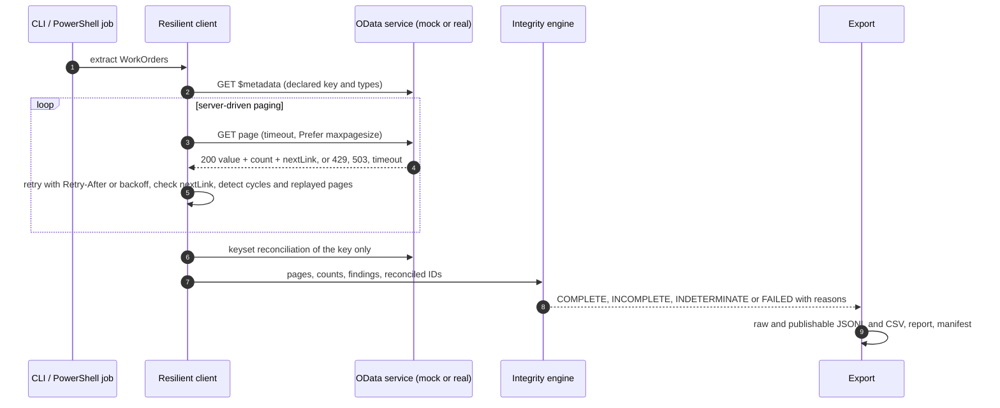

# Architecture

## Components

| Module | Responsibility |
| --- | --- |
| `dataset.py` | Entity definitions and the seeded synthetic dataset (fictional company) |
| `query.py` | The OData query subset the mock understands: `$filter`, `$orderby`, `$select`, `$top`, `$skip`, `$count`, `$skiptoken` |
| `mock_server.py` | Local OData v4 service over the dataset, `$metadata`, server-driven paging, deterministic fault injection |
| `faults.py` | The 15 failure scenarios, each marked conformant or provider defect, with its expected integrity status |
| `transport.py` | urllib transport (explicit timeout, no redirects, no proxies) and injectable clocks |
| `client.py` | Retries, Retry-After, backoff with jitter, budgets, nextLink safety, cycle and replay detection, key reconciliation |
| `integrity.py` | Turns an extraction into a status with reasons, warnings and the checks that passed |
| `schema.py` | CSDL `$metadata` parsing and sample-based inference with provenance labels |
| `privacy.py`, `export.py` | Publishing rules, raw versus publishable output, manifest and `validate` |
| `pipeline.py` | Key discovery, extraction, assessment, output |
| `demo.py`, `cli.py` | Demo trace generation and the `odata-extractor` command |
| `tools/Invoke-ExtractionJob.ps1` | PowerShell 7 wrapper for scheduled multi-entity runs |

## Technology choices

- **Python standard library only at runtime.** `urllib` is enough for a client whose value is in its policy (timeouts,
  retries, link checks), and an injectable transport keeps that policy testable without a network. `http.server`
  runs the mock. No dependency means no supply-chain surface and an offline install. `pytest` is the only
  development dependency.
- **PowerShell 7 where it is natural.** Operations teams often schedule jobs with PowerShell. The wrapper runs the
  extractor per entity, collects each `report.json` into a run summary CSV and turns the worst integrity status
  into the process exit code. It contains no extraction or integrity logic, so nothing is implemented twice. It is
  tested from pytest on both Windows and Linux runners.
- **No framework.** Retries, paging and integrity rules are small, explicit and tested directly.

## Design decisions

- **Technical errors and integrity problems are different things.** The client raises `ExtractionError` only
  when it cannot reach a defined end; everything about whether the data is complete is decided by the integrity
  engine from what was received.
- **An independent second read.** After paging, the client lists the key alone with keyset filters
  (`$filter=Key gt last`). Offset paging and keyset paging fail in different ways, so agreement between them is
  much stronger evidence than a count. It is optional and degrades to "unavailable" when the provider cannot
  filter on the key.
- **Determinism for evidence.** Faults are keyed to page numbers and attempts, waits go through an injectable
  clock, and jitter uses a seeded random generator in tests and in the demo, so every recorded trace is
  reproducible.
